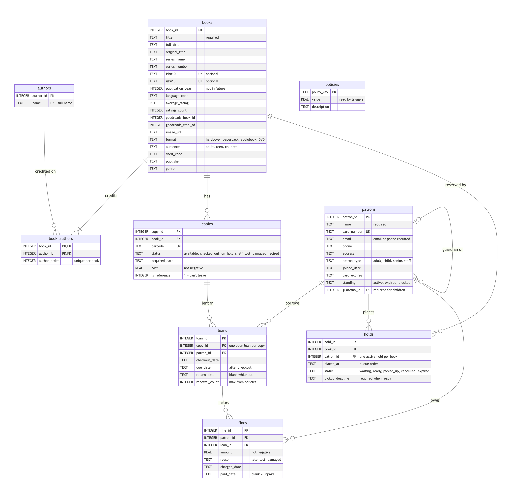
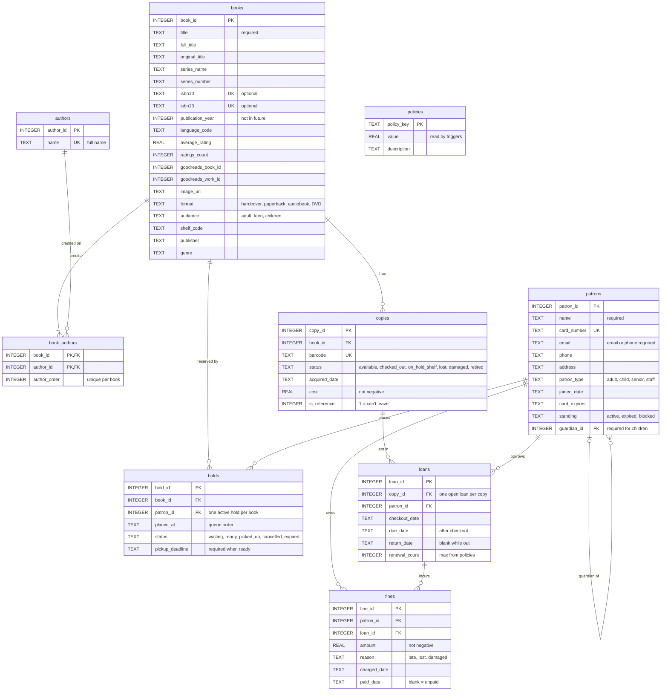

# Library Database: Design Summary

I'm opening a small library, and `library.db` is the SQLite database that runs it. My goal was a database that doesn't just store information but **holds the library to its rules**. If someone tries to lend a book to a blocked member or check out a copy that's already out, the database itself refuses.

## What each table represents, and why it exists

| Table | Represents | Why it exists |
|---|---|---|
| `books` | A title in the catalog (10,000 of them) | Facts about a title (author, ISBN, year) are stored once, no matter how many copies we own |
| `authors` | A person, stored as one full name | So each author exists once, even if they wrote 50 books. Names aren't split, because of names like "Homer" and "Kurt Vonnegut Jr." |
| `book_authors` | One credit: "this person is listed on this book, in this position" | Connects books and authors, since a book can have several authors and an author many books |
| `copies` | A physical item on the shelf, with a barcode | We own 1 to 3 copies of popular titles, and each copy has its own status, cost and loan history |
| `patrons` | A library member | Who can borrow, how to reach them, and whether they're in good standing. A child's record points to their guardian |
| `loans` | One checkout of one copy by one patron | The library's permanent history. Old loans are never deleted |
| `holds` | A reservation for a title | So members can line up for a book whose copies are all out. The queue is ordered by when each hold was placed |
| `fines` | A charge for a late, lost or damaged item | So we know who owes what. Too much unpaid stops a member from borrowing |
| `policies` | One library setting, like "children can have 5 items out" | Rules that may change live in data, not code. Changing a limit means editing one row |

## Relationships, and how the database keeps track of them

**One-to-many** relationships are tracked with a **foreign key**: a column in the "many" table that holds the ID of a row in the "one" table.
- One book has many copies (`copies.book_id`).
- One copy has many loans over its life (`loans.copy_id`).
- One patron has many loans, holds and fines (`patron_id` in each).
- One loan can produce several fines (`fines.loan_id`).
- One patron can be the guardian of several children (`patrons.guardian_id`, a table pointing to itself).

The database checks every foreign key, so a loan can't point to a copy that doesn't exist.

**Many-to-many** relationships need a table in the middle, called a **junction table**:
- **Books ↔ authors** go through `book_authors`. Each row is one book-and-author pair. The pair is the primary key, so the same person can't be credited twice on a book. A second unique rule stops two people from sharing the same position.
- **Patrons ↔ copies** are also many-to-many over time. A patron borrows many copies, and each copy goes home with many patrons. `loans` is the junction table here, and it carries its own information: dates and renewals. A special unique rule allows only one *unreturned* loan per copy, so a copy can't be out to two people at once.

## One design decision: separating books from copies

The biggest decision was splitting **books** (titles) from **copies** (physical items). If they were one table, owning three copies of *The Hunger Games* would mean storing its title, author and ISBN three times, and fixing a typo in one row would make the copies disagree. More importantly, status belongs to the item, not the title: one copy can be checked out while another is on the shelf.

Splitting them also made the rest of the design work naturally. Loans point to a specific copy (the one you carry home), while holds point to a book, because when you reserve *The Hunger Games*, you'll take whichever copy comes back first. This is why three people can be waiting for that title while its three copies are each out to someone else.

## One thing Claude got wrong, and what I changed

When checking the data before designing anything, Claude **guessed the column names** in `books.csv` (for example `isbn` instead of the real `isbn10`) instead of reading the file first, so its first check crashed. The second attempt worked but was written so inefficiently it would have taken many minutes, and it had to be stopped and rewritten. The lesson for me: **look at the real data before writing code about it**, and don't take an AI's first attempt as automatically correct, even when the final result works.

What I changed: I added five Harry Potter members to make the sample data more fun. Hermione returns everything early, Ron has an overdue *Charlotte's Web* (spiders), and Draco has never borrowed a thing. Claude added them to the build script rather than typing them into the database, so they survive every rebuild. It then reran all 50 rule tests to confirm nothing broke.

---

# Appendix

The ERD as Mermaid text (source: <code>erd.mmd</code>)

**Reading the diagram:** PK = primary key (identifies each row), FK = foreign key (points to another table), UK = unique. On each line, two bars mean "exactly one," a bar and circle "zero or one," a circle and crow's foot "zero or more," and a bar and crow's foot "one or more." `policies` has no lines because no column points to it; the database's automatic checks (triggers) read it instead.

**Files:**

| File | Purpose |
|---|---|
| `build_db.py` | Rebuilds `library.db` from scratch |
| `test_rules.py` | Tries to break every rule (50 checks) |
| `queries.sql` | A typical day at the desk, in 9 queries |
| `SCHEMA.md` | Plain-English guide to every table and rule |
| `erd.mmd`, `erd.png` | The diagram, as text and as an image |
